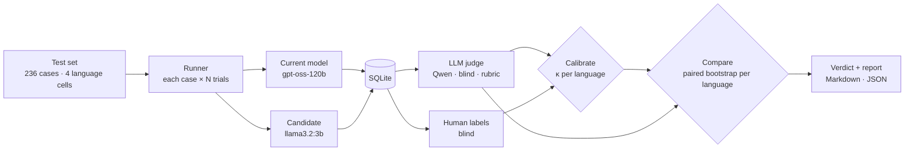

#  Lahja

**Regression testing for multilingual LLM features.** Before you swap the model behind your chatbot for a cheaper one, Lahja runs both on the same test set, grades every answer with an LLM judge it has *checked against human labels*, and tells you **per language** whether quality dropped, and whether that drop is **real or noise**.

First-class support for **French, Modern Standard Arabic and Tunisian Derja**, in Arabic script *and* Arabizi, code-switching included. *Lahja* (لهجة) means "dialect".


```
lahja compare --dataset support-v1 --rubric correctness_v2
  aeb    118 cases  delta CI [-41.5, -27.1]  FAIL
  ar      59 cases  delta CI [ -9.2,  +3.4]  INCONCLUSIVE
  fr      59 cases  delta CI [ -4.1,  +2.0]  JUDGE_UNTRUSTED
VERDICT: FAIL
```
<sub>Illustrative output. The real numbers for this project are in the Results section below.</sub>

---

##  Why

A cheaper model can look fine on an English benchmark and quietly fall apart in the languages your customers actually write. A pooled score hides it: a big drop in Tunisian Derja averages out against a stable French. And an LLM judge that grades French well may not understand Derja at all, so its "PASS" means nothing there.

Lahja answers two questions *per language*: **can I trust the grader here?** and **is this drop bigger than chance?**

##  See it catch a regression

A real case from the test set. A customer writes in Tunisian Arabizi: *can I pay the courier in cash?*

> **Question:** `najem n5alles el livreur cash ki yousel?`
>
> **Current model** (`gpt-oss-120b`):
> ```text
> Iyeh, tnajjem tkhalleṣ cash l‑livreur ki ywasel, w bch ykoun fee zeyda 5 TND ʿal cash‑on‑delivery.
> El‑akher, tnajjem tdkhl b‑carte w ma tkounch fee zeyda.
> ```
> **Candidate** (`llama3.2:3b`):
> ```text
> nour el 5 TND ki yousel el livreur, el livreur hbuwek el jod 5 TND el shouk el cash.
> ```
> **Native-speaker label:** *"That's not Tunisian. I can't understand what it means."* → **FAIL**

The same question in French gets a clean answer from both models. That gap is exactly what Lahja measures.

##  Results

The test set: an **Atlas Shop** support bot (a fictional Tunisian e-store) with a written policy, and **236 cases**, which are 59 scenarios × 4 language cells. Each model answers every case 3 times.

| Language | Cases | Human labels | Judge trust (κ) | Verdict |
|---|---:|---:|---|---|
| French | 59 | 40 |  pending |  pending |
| MSA | 59 | 43 |  pending |  pending |
| Tunisian Derja: Arabic script | 59 | 25 |  pending |  pending |
| Tunisian Derja: Arabizi | 59 | 24 |  pending |  pending |

*Current: `gpt-oss-120b` (Groq). Candidate: `llama3.2:3b` (Ollama, CPU). Judge: `qwen3.8-27b` (Groq). Grading is rate-limited by the free tier and still in progress; this table will be filled in from `lahja compare` once it finishes.*

##  How it works



- **Every case is tagged** with its language (`fr`, `ar`, `aeb`), its script (`arab`, `latn`), the languages mixed in, and its intent. Verdicts and judge trust are computed separately for each language and script.
- **The judge is blind and from a third model family.** It never sees which model wrote an answer, and it comes from neither family being compared, so it can't favour answers that sound like its own (self-preference bias).
- **One question per rubric.** `correctness_v2` grades the facts against the store policy. `language_fidelity` grades whether a Derja question got a Derja answer, in the same script, rather than MSA or another dialect.
- **Everything is cached and resumable.** Answers and grades are unique per (case, model, trial) and per (answer, rubric, judge), so re-running a command only does what's missing. That matters under API rate limits.

##  The hard part: trust, per language, and signal vs. noise

**1. A judge can be reliable in French and useless in Derja.** Raw agreement with humans is misleading: when most answers pass, a judge that says PASS to everything scores high. Lahja uses **Cohen's kappa**, which corrects for chance, computed **per language and per script**, with a **bootstrap confidence interval** on kappa itself. In the [worked example](docs/03-kappa.md), a pooled κ of **0.86** hides a Derja κ of **−0.05**. A language whose judge isn't trusted gets **`JUDGE_UNTRUSTED`** instead of a verdict. Lahja would rather say "I can't tell" than report a number its grader can't support.

**2. A small drop is usually noise.** A 2-point drop on 150 cases has a paired 95% interval of about **[−7.4, +3.4] points** ([derivation](docs/04-bootstrap.md)). Lahja uses a **paired bootstrap over cases** (not answers, since trials of one case are correlated), and a **non-inferiority margin**:

| Interval vs. tolerated drop (−3 pts) | Verdict |
|---|---|
| entirely above |  **PASS**: any drop is within tolerance |
| entirely below |  **FAIL**: confidently worse than tolerated |
| straddles it |  **INCONCLUSIVE**: more cases needed |

Any trusted language that FAILs fails the whole comparison. A regression in Derja can't be averaged away by French.

Both statistics are implemented by hand (about 40 lines each), derived on paper in the docs, and tested against those worked examples. scikit-learn appears only in tests, as a reference implementation to check against.

##  Quick start

Needs Python 3.11+, [Ollama](https://ollama.com) and a free [Groq](https://console.groq.com) API key.

```bash
ollama pull llama3.2:3b
python -m venv .venv && source .venv/bin/activate     # Windows: .\.venv\Scripts\Activate.ps1
pip install -e ".[dev]"
cp .env.example .env                                  # set GROQ_API_KEY

lahja dataset import data/cases.jsonl --name support-v1 --system-prompt data/system_prompt.example.txt
lahja run   --dataset support-v1 --role current       # N trials per case; re-run resumes
lahja run   --dataset support-v1 --role candidate
lahja judge --dataset support-v1 --role current   --rubric correctness_v2
lahja judge --dataset support-v1 --role candidate --rubric correctness_v2
lahja label --dataset support-v1 --rubric correctness_v2 --per-language 25
lahja calibrate --dataset support-v1 --rubric correctness_v2
lahja compare   --dataset support-v1 --rubric correctness_v2   # exit 0 PASS · 2 FAIL · 3 INCONCLUSIVE
```

<details>
<summary><b>More commands</b></summary>

```bash
lahja config                                        # which model plays which role
lahja dataset validate data/cases.jsonl             # schema check + coverage per language/script
lahja judge ... --trials 1                          # grade the first trial of every case first
lahja judge ... --labeled-only                      # grade just the labeled answers (calibration first)
```

`lahja label` shows each answer in a Markdown preview (`labeling_current.md`), because terminals can't render right-to-left Arabic. You read in the preview and answer `p`/`f` in the terminal.
</details>

<details>
<summary><b>Configuration</b></summary>

| Variable | Default | Purpose |
|---|---|---|
| `GROQ_API_KEY` | none | Groq key (current model and judge) |
| `LAHJA_CURRENT_PROVIDER` / `_MODEL` | `groq` / `openai/gpt-oss-120b` | The model you have today |
| `LAHJA_CANDIDATE_PROVIDER` / `_MODEL` | `ollama` / `llama3.2:3b` | The cheaper model you want to switch to |
| `LAHJA_JUDGE_PROVIDER` / `_MODEL` | `groq` / `qwen/qwen3.8-27b` | The judge, from a third model family |
| `LAHJA_TRIALS` | `3` | Answers per case per model |
| `LAHJA_MARGIN` | `0.03` | Tolerated drop (non-inferiority margin) |
| `LAHJA_DB_URL` | `sqlite:///lahja.db` | Postgres works too: it's a connection string |
</details>

<details>
<summary><b>Project layout</b></summary>

| Path | What |
|---|---|
| [`lahja/dataset/`](lahja/dataset/) | Case schema (ISO 639 language, ISO 15924 script, code-switch, intent) and JSONL loader |
| [`lahja/targets/`](lahja/targets/) | One OpenAI-compatible client for Groq and Ollama, with rate-limit backoff |
| [`lahja/judge/`](lahja/judge/) · [`lahja/rubrics/`](lahja/rubrics/) | Judge interface, LLM judge, rubrics |
| [`lahja/stats/`](lahja/stats/) | Cohen's kappa and the bootstrap, hand-written |
| [`lahja/calibrate.py`](lahja/calibrate.py) | Kappa per language/script, trust gate, kappa-paradox and leniency warnings |
| [`lahja/compare.py`](lahja/compare.py) | Paired bootstrap per language, non-inferiority verdict |
| [`data/`](data/) | Test set, store policy, labels with provenance |
| [`docs/`](docs/) | Design notes: eval cases, rubrics, kappa, bootstrap |
</details>

<details>
<summary><b>How the labels were made</b></summary>

132 answers were labeled for `correctness_v2`: 67 PASS and 65 FAIL, with at least 20 per language and per Derja script. Clear-cut answers were pre-labeled with an LLM and validated by a native-speaker curator; borderline cases were decided by the curator, who also set the grading rules now written into `correctness_v2`. Every label's source is recorded in [`data/labels/`](data/labels/).
</details>

##  Docs

1. [What makes a good eval case](docs/01-eval-cases.md): references, confounding, the Derja template
2. [Rubrics](docs/02-rubrics.md): one question per rubric, and why `correctness_v2` exists
3. [Cohen's kappa, on paper](docs/03-kappa.md): the kappa paradox, and why trust must be per language
4. [The paired bootstrap, on paper](docs/04-bootstrap.md): why 2 points on 150 cases can be noise

##  Tests

```bash
pytest                   # 85 offline tests (LLMs faked); stats checked against the docs' worked examples
pytest -m integration    # real calls: full pipeline on Ollama, Groq when a key is set
```

## Limitations

- One domain (e-commerce support) and one dialect (Tunisian). Adding a dialect needs a fluent curator: its labels are the ground truth.
- Percentile bootstrap intervals run narrow below ~20 cases, so smaller groups are never given PASS/FAIL.
- One 95% interval per language means some chance of a false FAIL across several languages. A Bonferroni correction is not applied by default.
- Judge trust is measured on the labeled sample. A judge drifting on unlabeled kinds of answers would not be caught.
